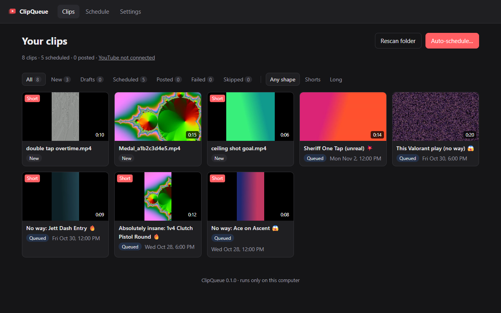
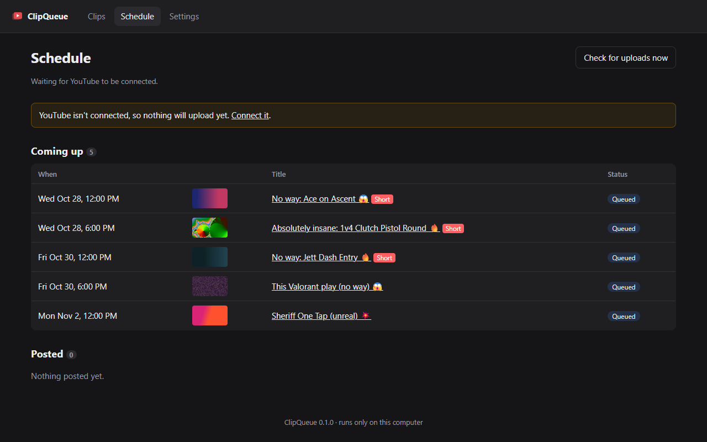
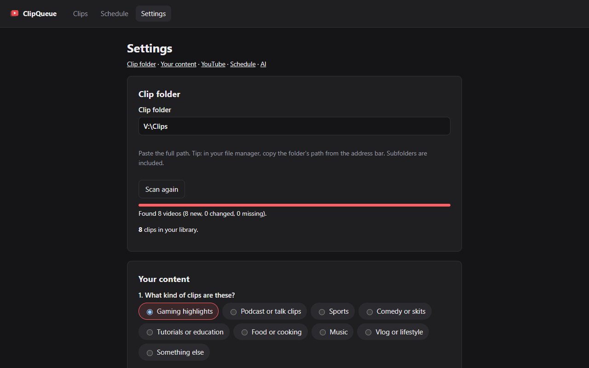

# ClipQueue

Turn a folder of old video clips into a YouTube posting schedule. ClipQueue runs on your own computer, suggests titles and hashtags in your style, and uploads to YouTube on the days and times you choose.

- **Local-first.** A small web app on `127.0.0.1`. No ClipQueue account and no telemetry. Nothing leaves your machine except the uploads you schedule.
- **Free.** No paid API needed. Title suggestions work offline.
- **Your keys.** You connect YouTube with your own Google API credentials, and they stay in your local data folder.

> **YouTube only.** TikTok and Instagram aren't supported because their posting APIs require per-app review that a self-hosted open-source tool can't realistically pass. See [docs/PLAN.md](docs/PLAN.md).

## What it does

1. **Scans your clip folder** (including subfolders) and flags which clips will be YouTube **Shorts** (vertical or square, up to 3 minutes).
2. **Asks 8 quick questions** about your content: the type of clips, games or topics, audience, tone, title style, titles you like, hashtags to always or never use, and a call to action.
3. **Suggests titles, descriptions, hashtags and tags** in that style. It works offline, and can optionally use your local [Claude Code](https://claude.com/claude-code) CLI with your own plan.
4. **Schedules uploads.** Clips upload a few hours or days ahead as private with a publish time, so YouTube makes them public on schedule even if ClipQueue is closed by then.

## Screenshots

**Clips:** your whole library at a glance, with Shorts flagged, scheduled times and one-click auto-scheduling.



**Schedule:** what's coming up, what's uploading and what's been posted.



**Settings:** clip folder, your content profile, YouTube connection, posting schedule and AI options.



## Before you start

**Setup takes about 20–30 minutes:**

- **About 5–10 minutes** to install Python, ffmpeg (optional but recommended), and ClipQueue.
- **About 10–15 minutes** to connect YouTube. You create your own free Google Cloud project, and the app walks you through it step by step. Google will warn that the app is "unverified." That's normal, because you're the developer of your own copy.

**What to expect:**

- **YouTube only.** No TikTok or Instagram.
- **About 5 uploads a day**, because of YouTube's free API limits.
- **Reconnect every 7 days**, unless you follow [the step in the setup guide](docs/setup-youtube.md#sign-in-expired-after-a-week) that stops this.
- **Uploads may end up private.** Google sometimes forces uploads from personal projects to private. If that happens, ClipQueue tells you and you publish them by hand in YouTube Studio.
- **Open it now and then.** ClipQueue needs to be running to upload clips before their scheduled time. YouTube publishes them on time even if it's closed by then.
- **Early version.** Expect rough edges, and please [report bugs](https://github.com/pmurphinc/clipqueue/issues).

## Let an AI coding agent set it up

If you use [Claude Code](https://claude.com/claude-code), Codex, or a similar coding agent, you can skip the manual install. Give it the repo URL and ask it to set ClipQueue up:

> Set up https://github.com/pmurphinc/clipqueue on my computer and start it.

It can install Python and ffmpeg, install ClipQueue, and launch it. You'll still do the Google Cloud and YouTube sign-in steps yourself in your browser, because they need your Google account.

## Quick start

You need **Python 3.11+**. **ffmpeg** is strongly recommended, for clip length, shape and thumbnails.

```bash
pip install git+https://github.com/pmurphinc/clipqueue.git
clipqueue
```

Or from a clone:

```bash
git clone https://github.com/pmurphinc/clipqueue.git
cd clipqueue
python -m venv .venv
# Windows: .venv\Scripts\activate    macOS/Linux: source .venv/bin/activate
pip install -e .
clipqueue
```

Your browser opens to `http://127.0.0.1:8765` and the setup wizard walks you through the rest. Connecting YouTube takes about 10–15 minutes; see [docs/setup-youtube.md](docs/setup-youtube.md).

Installing ffmpeg: `winget install Gyan.FFmpeg` (Windows), `brew install ffmpeg` (macOS), or `sudo apt install ffmpeg` (Debian/Ubuntu).

### Options

```
clipqueue --port 8765          # choose a port
clipqueue --no-browser         # don't open a browser tab
clipqueue --data-dir PATH      # where to keep data (default: ~/.clipqueue)
```

## Where your data lives

Everything is stored in `~/.clipqueue`, or the folder set by `--data-dir` or `CLIPQUEUE_HOME`:

| File | What |
|---|---|
| `settings.json`, `profile.json` | Your setup and interview answers |
| `clipqueue.db` | Clip library, drafts and schedule (SQLite) |
| `thumbs/` | Thumbnail cache |
| `client_secret.json`, `youtube_token.json` | Your Google OAuth client and sign-in token. **Keep these private.** |

ClipQueue never modifies, moves or deletes your video files.

## Things to know about YouTube

- **Daily limits.** YouTube's free API quota allows only a few uploads per day, so ClipQueue has a daily cap (default 5). If YouTube says the quota is used up, ClipQueue waits until tomorrow.
- **Unverified projects.** Google may lock uploads from personal, unverified API projects to private. ClipQueue checks each upload and tells you if this happened. See the [setup guide](docs/setup-youtube.md#if-uploads-end-up-private).
- **7-day sign-ins.** While your Google project is in "Testing" mode, sign-ins expire after 7 days. The setup guide explains how to avoid that.
- **No Shorts switch.** The API has no "upload as Short" option. YouTube decides from the video's shape and length. ClipQueue adds `#shorts` to Shorts-eligible clips.

## Development

```bash
pip install -e ".[dev]"
pytest
```

Layout:

```
src/clipqueue/
  __main__.py        command line entry point
  app.py             web routes (FastAPI)
  config.py          data folder + settings
  db.py              SQLite clip library
  scanner.py         folder scan, ffprobe, thumbnails
  profile.py         interview questions + answers
  generate/
    offline.py       template-based titles and hashtags
    claude_cli.py    optional local `claude` CLI integration
  youtube.py         OAuth + uploads
  scheduler.py       posting slots + background uploader
  templates/, static/
tests/
```

See [CONTRIBUTING.md](CONTRIBUTING.md).

## License

[MIT](LICENSE)
